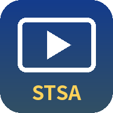

  

<h1 align="center">STSA TV</h1>

  免費電視，自動更新 · Free TV that keeps itself working 
  Android 手機 · Android TV · Google TV

---

## 📺 這是什麼 What it is

一個家用電視 App：自動找到免費頻道、每天檢查連結、壞掉的自動換掉。
A home TV app that finds free channels, checks them every day and replaces broken links by itself.

## ✨ 功能 Features

| | 中文 | English |
|---|---|---|
| 🇹🇼🇿🇦 | 台灣與南非頻道，各自獨立資料夾 | Taiwan and South Africa in their own folders |
| 🏉⚽ | 橄欖球與體育，需 VPN 的會標示國家 | Rugby and sports, VPN country shown when needed |
| 📰🎬 | 依類型分類：新聞、電影、兒童… | Sorted by type: news, movies, kids… |
| 🔄 | 每天背景自動檢查，開啟即可看 | Silent daily check, opens instantly |
| 📅 | 節目表與頻道圖示 | TV guide and channel logos |
| ❤️ | 我的最愛 | Favorites |
| 🌐 | 中文 / English 切換 | Chinese / English switch |
| 🎨 | 外觀：跳羚綠金 / 經典藍 | Look: Springbok / Classic |

## 🎮 遙控器 Remote

| 按鍵 Key | 看電視時 While watching | 頻道清單 In the list |
|---|---|---|
| ↑ / ↓ | 換台 Change channel | 上下移動 Move |
| ← / → | — | 翻頁 Page |
| OK | 開啟頻道清單 Open list | 播放 Play |
| 長按 OK Hold OK | 加入最愛 Favorite | 加入最愛 Favorite |
| 返回 Back | 回到列表 Back to list | 資料夾 Folders |

手機 Phone：上下滑換台 · 點一下開清單 · 長按加入最愛
Swipe = channel · Tap = list · Long-press = favorite

## 📥 安裝 Install

**Actions** → 最新的 Build APK → **Artifacts** → `STSA-TV-vX.X` → 解壓縮並安裝 unzip and install.

---

頻道來源 Channels: iptv-org · Free-TV &nbsp;|&nbsp; 節目表 Guide: epgshare01 · globetvapp &nbsp;|&nbsp; 僅供家庭使用 Family use only
